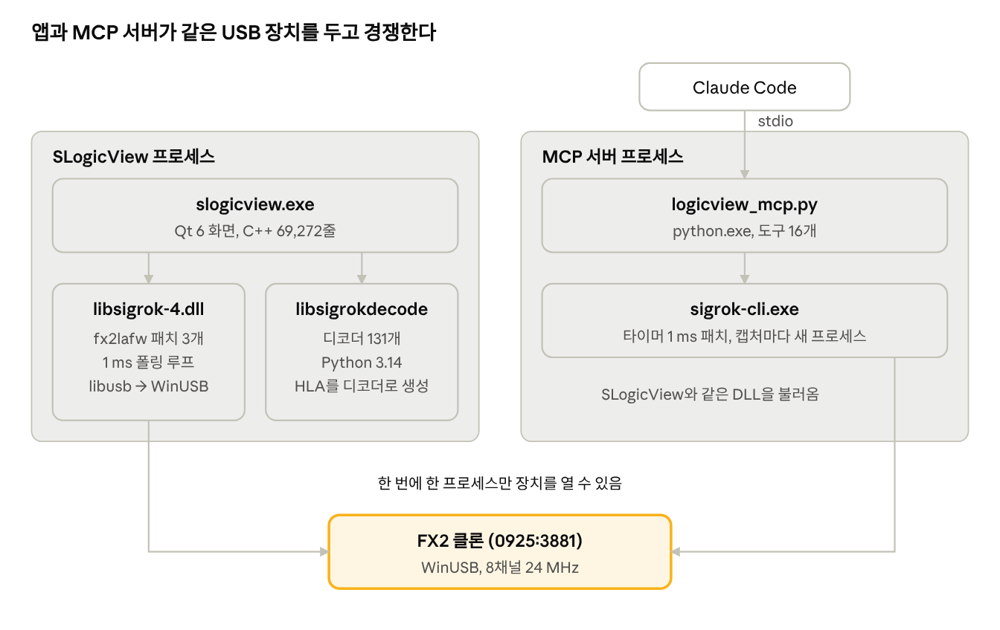
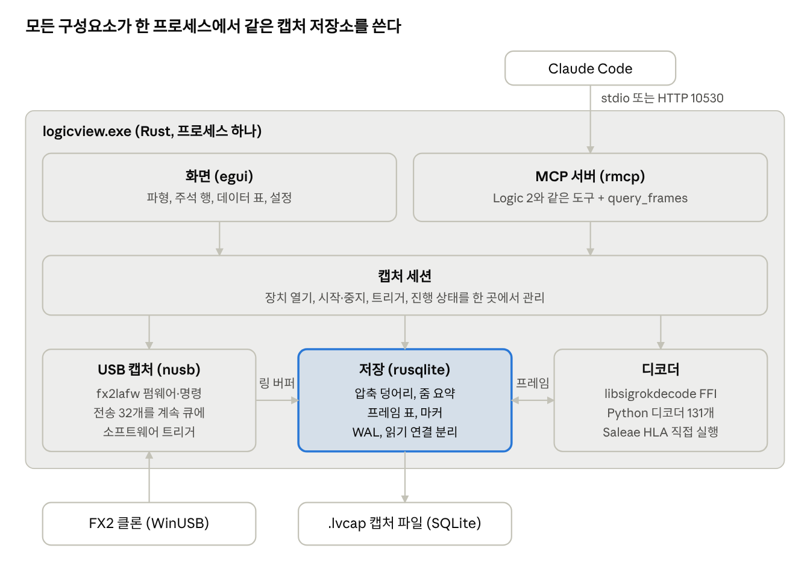
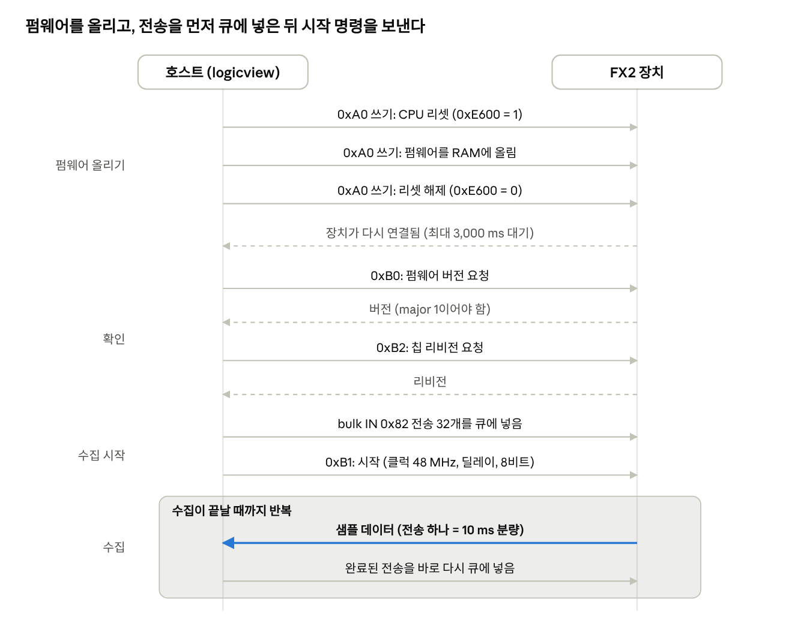
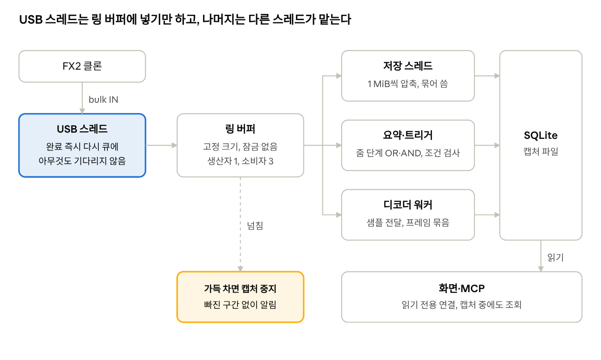
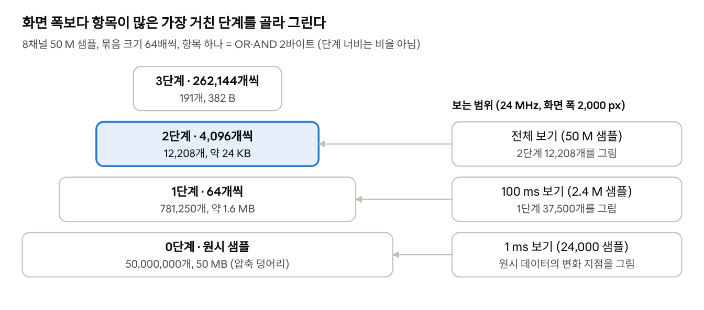
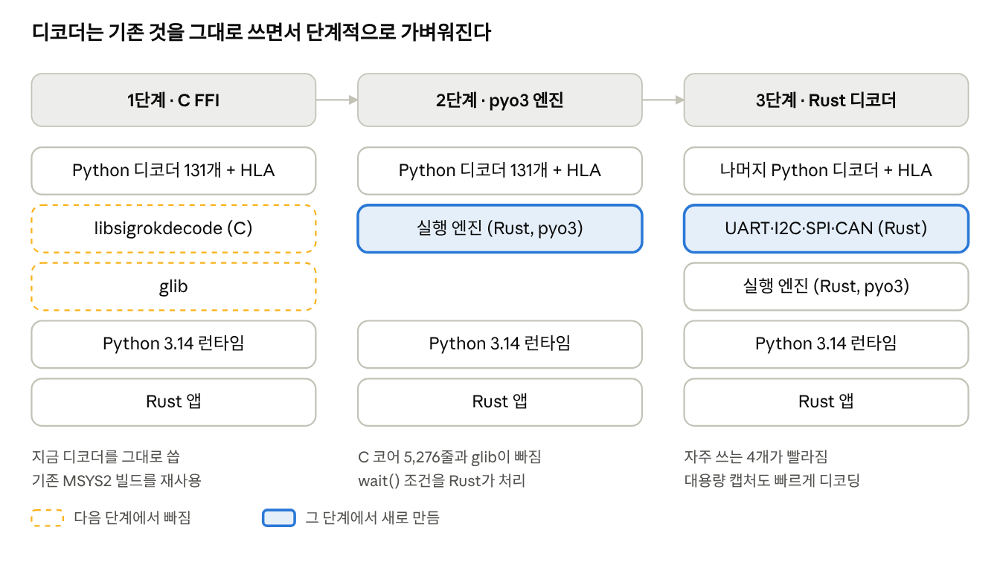
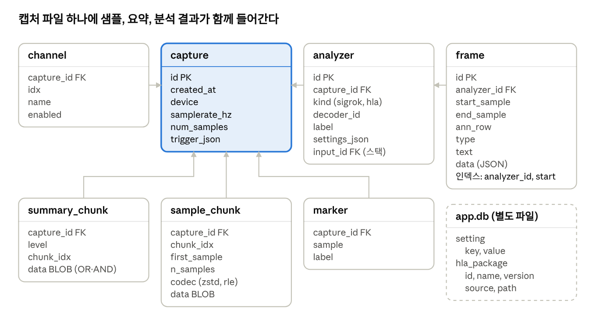
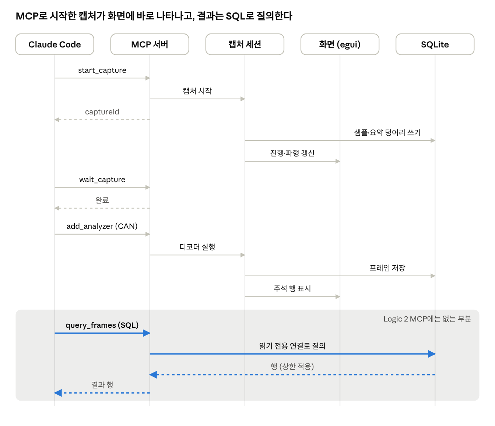
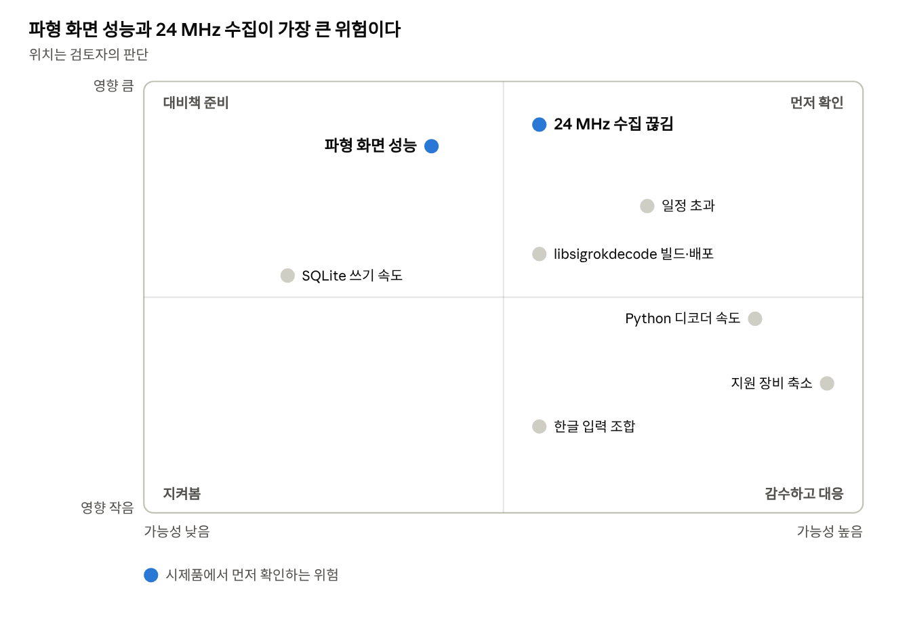
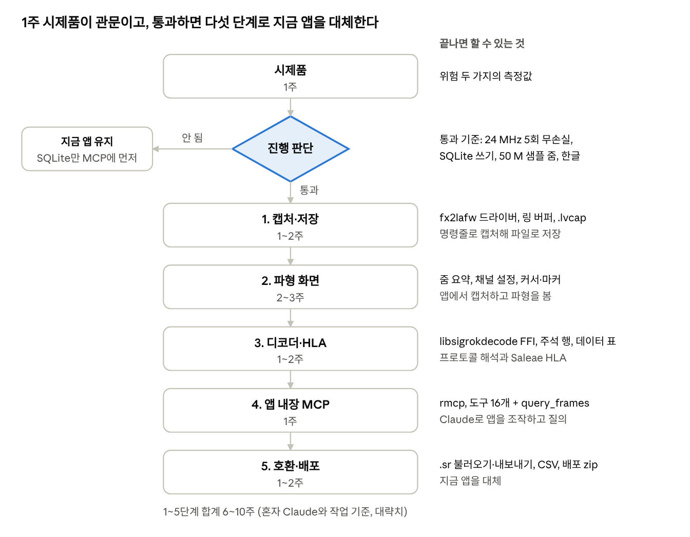

# logicview Rust·egui 전환 검토

2026-11-10

## 요약

logicview를 Rust와 egui로 다시 만드는 것은 가능하고, 권장합니다. 다만 전부를 새로 쓰지 않고 **캡처·저장·화면·MCP는 Rust로 새로 쓰고, 프로토콜 디코더는 기존 sigrok 디코더 131개를 그대로 불러 쓰는** 방식입니다. SQLite는 캡처 하나를 파일 하나로 담는 저장소이자 디코딩 결과를 질의하는 데이터베이스로 씁니다.

| 구분 | 내용 |
| --- | --- |
| 얻는 것 | DLL 59개(141.6 MB)를 실행 파일 하나와 Python 정도로 줄임. 24 MHz 끊김을 부른 폴링 구조가 사라짐. MCP가 앱 안에 들어가 캡처가 화면에 보임. 디코딩 결과를 SQL로 질의 |
| 대가 | 지원 장비가 fx2lafw(이후 SLogic)로 줄어듦. 지금 쓰는 기능 수준까지 6~10주 (혼자 Claude와 작업 기준, 대략치) |
| 먼저 할 일 | 1주짜리 시제품으로 두 가지 위험을 확인: Windows에서 24 MHz를 끊김 없이 받아 SQLite에 쓰기, egui로 5천만 샘플 파형을 부드럽게 줌·이동하기 |

두 가지가 확인되면 본 개발로 가고, 안 되면 지금 앱을 유지하면서 SQLite만 MCP 서버에 먼저 넣습니다.

## 현재 구조와 한계

지금 logicview는 Sipeed SLogicView 2.3.3(PulseView 계열, C++ 69,272줄) 바이너리에 fx2lafw를 넣어 다시 빌드한 libsigrok를 끼운 구조입니다. MCP 서버는 별도 Python 프로세스가 sigrok-cli를 실행하는 방식이라, 두 프로세스가 같은 USB 장치를 두고 경쟁합니다.



두 프로세스가 각자 libsigrok를 불러 같은 장치를 열려고 하므로, 한쪽이 열고 있으면 다른 쪽은 캡처할 수 없습니다.

| 한계 | 근거 |
| --- | --- |
| 배포가 무겁다 | 앱 폴더에 DLL 59개, 141.6 MB (Qt 6, boost, glibmm, ICU 33 MB 등) |
| 빌드가 복잡하다 | MSYS2 UCRT64로 C 라이브러리 3개를 빌드하고 libsigrok 패치 3개, sigrok-cli 패치 1개를 적용 |
| USB 처리가 타이머에 묶여 있다 | libsigrok는 1 ms 폴링 루프로 USB 완료를 처리하는데, Windows 기본 타이머는 15.6 ms라 고속 수집이 밀림. sigrok-cli는 패치로 1 ms로 올렸음 |
| WinUSB 설정을 패치로 맞춰야 한다 | RAW_IO가 꺼져 있으면 bulk IN 요청이 하나씩만 나가 24 MHz에서 FX2 버퍼가 넘침 (패치 0003) |
| MCP가 앱과 따로 논다 | MCP 캡처는 화면에 보이지 않고, SLogicView가 장치를 열고 있으면 MCP로 캡처할 수 없음 |
| HLA를 우회해서 붙였다 | Saleae HLA를 sigrok 디코더로 감싸려고 HLA·프로토콜마다 디코더를 생성하고, 입력은 UART·I2C·SPI·CAN으로 제한 |

## 목표 구조

새 logicview는 프로세스 하나입니다. 화면, USB 캡처, 저장, 디코더, MCP 서버가 같은 캡처 저장소(SQLite)를 공유하므로, 장치를 두고 경쟁할 일이 없고 MCP로 한 캡처도 바로 화면에 나타납니다.



화면과 MCP는 모두 캡처 세션 하나를 거쳐 장치를 다루고, 결과는 저장 계층(SQLite)에서 함께 읽습니다.

| 역할 | 쓸 것 | 고른 이유 |
| --- | --- | --- |
| USB | [nusb](https://docs.rs/nusb/latest/nusb) | 순수 Rust, Windows에서는 WinUSB를 직접 씀. IN 엔드포인트를 열 때 RAW_IO를 자동으로 켬 ([소스](https://raw.githubusercontent.com/kevinmehall/nusb/main/src/platform/windows_winusb/device.rs)). 여러 전송을 큐에 쌓는 방식 |
| 화면 | egui + eframe | 즉시 모드 UI라 파형처럼 매번 그리는 화면에 맞음. 실행 파일 하나로 배포 |
| 저장 | rusqlite (SQLite 내장 빌드) | 캡처 파일, 디코딩 결과, 설정을 한 곳에. 트랜잭션과 인덱스 |
| 디코더 | libsigrokdecode C API (직접 만드는 FFI) | 디코더 131개와 HLA 호환 계층을 그대로 씀. Rust 바인딩은 따로 없음 |
| MCP | [rmcp](https://docs.rs/crate/rmcp) (공식 Rust SDK) | stdio와 Streamable HTTP 서버를 모두 지원 |
| 파일 호환 | zip + 자체 코드 | `.sr` 불러오기·내보내기, CSV·Saleae 바이너리 내보내기 |

libsigrok의 Rust 바인딩으로는 [sigrok-sys](https://docs.rs/crate/sigrok-sys/0.2.0/)가 있지만 docs.rs 빌드가 실패한 상태라 쓰지 않고, USB 드라이버는 직접 구현합니다.

## 캡처 파이프라인

fx2lafw 프로토콜은 작아서 Rust로 직접 구현할 수 있습니다. libsigrok의 fx2lafw 드라이버는 C 1,283줄이고, 필요한 것은 펌웨어 업로드, 버전 확인, 시작 명령, bulk 스트리밍입니다. 아래 값은 저장소 `sources/libsigrok/src/hardware/fx2lafw/`와 `ezusb.c`에서 읽었습니다.



libsigrok도 같은 순서(`start_transfers` 다음 `command_start_acquisition`)를 따릅니다. 전송이 먼저 대기하고 있어야 첫 데이터부터 받을 수 있습니다.

| 항목 | 값 |
| --- | --- |
| 펌웨어 업로드 | vendor 요청 `0xA0`로 CPU를 리셋(`0xE600`에 1)하고 RAM에 쓴 뒤 리셋 해제. 장치가 다시 연결되기를 최대 3,000 ms 기다림 |
| 명령 | `0xB0` 펌웨어 버전(major 1 필요), `0xB2` 칩 리비전, `0xB1` 시작(클럭 48/30 MHz, 딜레이, 8/16비트 플래그) |
| 데이터 | bulk IN 엔드포인트 `0x82`. 전송 하나 = 10 ms 분량(512의 배수), 동시에 최대 32개. 24 MHz라면 240 KB × 32개 |
| 트리거 | 하드웨어 트리거가 없어 호스트가 데이터를 보며 찾음. 에지·레벨에 더해 펄스 폭 트리거도 같은 자리에서 구현 가능 |

중요한 원칙은 **USB 스레드가 아무것도 기다리지 않는 것**입니다. 완료된 전송은 곧바로 다시 큐에 넣고, 데이터는 링 버퍼로만 넘깁니다. 압축, SQLite 쓰기, 화면용 요약, 디코딩은 모두 다른 스레드에서 합니다. libsigrok처럼 폴링 루프가 없으므로 Windows 타이머 해상도에 묶이지 않습니다.



USB 스레드가 하는 일은 전송을 다시 큐에 넣고 링 버퍼에 복사하는 것뿐입니다. 소비자 세 스레드는 각자 자기 속도로 링 버퍼를 읽습니다.

링 버퍼가 차면 데이터를 버리지 않고 캡처를 멈추고 알려야 합니다. 조용히 빠진 구간이 있는 파형은 디버깅을 그르치기 때문입니다.

## 화면 설계 (egui)

파형 화면의 핵심은 화면에 그리는 양을 픽셀 수에 묶어 두는 것입니다. 24 MHz로 50 M 샘플을 받으면 채널당 값이 5천만 개이지만, 화면 폭은 2,000 픽셀 안팎입니다. 그래서 캡처하면서 줌 단계별 요약을 만들고, 그릴 때는 항목 하나가 픽셀 하나 이하가 되는 단계를 골라 읽습니다.



어느 배율에서든 그리는 항목은 화면 폭의 몇 배 정도로 제한되므로, 캡처 길이가 늘어도 그리기 비용은 거의 그대로입니다.

- **요약 항목:** 샘플 묶음마다 8채널 바이트의 비트 OR와 AND를 저장합니다(2바이트). 두 값으로 채널마다 "계속 0", "계속 1", "그 사이에서 바뀜"을 구분합니다. 바뀐 구간은 채운 띠로 그립니다.
- **단계:** 묶음 크기를 64배씩 키우면 50 M 샘플은 1단계 781,250개(약 1.6 MB), 2단계 12,208개, 3단계 191개가 됩니다. 원시 데이터의 3% 정도라 메모리에 두고 SQLite에도 함께 저장합니다.
- **크게 확대했을 때:** 원시 데이터에서 변화 지점만 캐서 선분으로 그립니다. 보이는 구간의 덩어리만 SQLite에서 읽고 압축을 풀어 캐시합니다.
- **디코딩 주석:** 보이는 시간 범위로 SQLite의 프레임 표를 인덱스 조회해서 그립니다. 너무 좁은 주석은 글자 없이 색 띠로만 표시합니다.
- **다시 그리기:** egui는 입력이 있을 때만 다시 그립니다. 캡처 중에만 초당 30회 정도로 다시 그리기를 요청합니다.
- **데이터 표:** 보이는 행만 그리는 가상 스크롤 표(egui_extras)에 SQLite 페이지 조회를 붙입니다.
- **한글:** egui 기본 글꼴에는 한글이 없습니다. 실행할 때 Windows의 맑은 고딕을 읽고, 없으면 함께 넣은 Noto Sans KR(OFL)을 씁니다. 한글 입력(IME) 조합은 시제품에서 확인해야 합니다.

## 디코더 전략

디코더는 다시 쓰지 않고 세 단계로 옮깁니다. 1단계만으로 지금과 같은 디코더 131개를 쓸 수 있고, 2·3단계는 배포 크기와 속도를 위한 선택입니다.



어느 단계에서든 Python 디코더와 HLA는 그대로 돌아가므로, 단계를 넘어갈 때 기능이 줄어들지 않습니다.

1. **1단계, libsigrokdecode를 C FFI로 호출:** `srd_init`, `srd_decoder_load_all`, `srd_session_new`, `srd_inst_new`, `srd_inst_stack`, `srd_pd_output_callback_add`, `srd_session_metadata_set`, `srd_session_start`, `srd_session_send`, `srd_session_terminate_reset` 정도만 감싸면 됩니다. 주석 콜백을 받아 SQLite 프레임 표에 묶어서 씁니다. 대신 glib과 Python 런타임이 남습니다.
2. **2단계, 디코더 실행 엔진을 pyo3로 Rust에 구현:** 디코더가 쓰는 `sigrokdecode` 모듈(`Decoder`, `wait()` 조건, `put()`, `register()`)을 Rust가 제공합니다. libsigrokdecode C 코어(11개 파일, 5,276줄)와 glib이 빠집니다. `wait()` 조건 처리를 Rust에서 하므로 샘플 단위 반복도 빨라집니다.
3. **3단계, 자주 쓰는 디코더만 Rust로:** UART, I2C, SPI, CAN을 Rust로 다시 짜서 대용량 캡처에서도 빠르게 디코딩합니다. 나머지는 Python 디코더를 그대로 씁니다.

Saleae HLA는 더 이상 sigrok 디코더로 감싸지 않습니다. 내장 Python으로 HLA를 직접 실행하고, SQLite에 쌓인 분석기 프레임을 Saleae 형식으로 바꿔 넣습니다. 그러면 HLA 입력을 UART·I2C·SPI·CAN 밖으로 넓히기 쉽고, HLA·프로토콜마다 디코더를 생성할 필요도 없습니다. 지금의 `saleae_bridge.py` 입력 변환 코드는 그대로 옮겨 쓸 수 있습니다.

## SQLite 저장 설계

캡처 하나를 SQLite 파일 하나(예: `.lvcap`)로 저장합니다. 원시 샘플, 줌 단계별 요약, 채널과 분석기 설정, 디코딩 프레임, 마커가 한 파일에 들어가므로, 파일을 보내면 분석 상태까지 그대로 전달됩니다. 앱 설정과 설치한 HLA 목록은 별도의 `app.db`에 둡니다.



화살표는 외래 키가 가리키는 방향입니다. `analyzer.input_id`는 다른 분석기를 가리켜서, 디코더 스택과 HLA 입력을 같은 방식으로 표현합니다.

**쓰기 경로**

- 원시 샘플은 1 MiB(24 MHz에서 약 44 ms) 덩어리로 자르고, zstd 또는 변화 지점 기반 압축을 거쳐 `sample_chunk.data`에 넣습니다. 압축률은 신호에 따라 다르므로 시제품에서 잽니다.
- WAL 모드, `synchronous=NORMAL`로 두고 저장 스레드 하나가 여러 덩어리를 한 트랜잭션으로 묶어 씁니다. 화면·MCP는 읽기 연결을 따로 열어 캡처 중에도 읽습니다.
- 원시 샘플을 SQLite에 넣기에 쓰기 속도가 모자라면, 샘플만 별도 파일에 두고 `sample_chunk`에는 오프셋만 저장합니다. 나머지 설계는 그대로입니다.

**질의 예**

CAN ID 0x123(291) 프레임만 시간순으로:

```sql
SELECT f.start_sample * 1.0 / c.samplerate_hz AS t_s,
       json_extract(f.data, '$.identifier') AS can_id
FROM frame f
JOIN analyzer a ON a.id = f.analyzer_id
JOIN capture c ON c.id = a.capture_id
WHERE a.label = 'CAN' AND f.type = 'identifier_field'
  AND json_extract(f.data, '$.identifier') = 291
ORDER BY f.start_sample;
```

화면에 보이는 구간의 주석 (인덱스 `frame(analyzer_id, start_sample)` 사용):

```sql
SELECT start_sample, end_sample, ann_row, text
FROM frame
WHERE analyzer_id = :a
  AND start_sample BETWEEN :lo - :max_len AND :hi
  AND end_sample >= :lo;
```

프레임 길이 차이가 크다면 SQLite의 R*Tree 모듈로 구간 색인을 따로 만듭니다. 프레임 텍스트 검색은 FTS5로 붙일 수 있습니다.

## MCP 통합

MCP 서버를 앱 안에 넣으면 Logic 2처럼 열려 있는 앱을 조작하게 됩니다. Claude가 시작한 캡처가 화면에 바로 나타나고, 디코딩 결과는 파일로 내보낼 필요 없이 SQLite에서 바로 읽습니다. 지금 Python 서버(1,367줄)의 도구 16개는 같은 이름과 인자로 옮깁니다.



`start_capture`는 바로 돌아오고, 캡처와 디코딩이 진행되는 동안 화면은 같은 세션에서 갱신됩니다. 음영 부분이 새로 생기는 SQL 질의 경로입니다.

| 도구 | 지금 | Rust 앱에서 |
| --- | --- | --- |
| Logic 2와 같은 15개 | sigrok-cli 프로세스를 실행하고 결과 파일을 읽음 | 앱의 캡처 엔진을 직접 호출. 캡처가 화면에 보임 |
| `read_analyzer_frames` | 디코더 출력 줄을 파싱 | `frame` 표를 범위로 조회 |
| `query_frames` (새 도구) | 없음 | 캡처 파일에 읽기 전용 SQL을 실행하고 행을 돌려줌 |
| 서버 실행 | 별도 프로세스 (stdio 또는 HTTP 10530) | 앱이 HTTP 10530을 열고, 앱 없이 쓸 때는 `logicview --mcp-stdio` |

`query_frames`는 읽기 전용 연결(`SQLITE_OPEN_READONLY`, `PRAGMA query_only`)에서만 실행하고, 돌려주는 행 수와 실행 시간에 상한을 둡니다. Claude가 "CAN ID별 프레임 수"나 "I2C NACK가 난 주소" 같은 질문을 SQL 한 번으로 답할 수 있게 됩니다. Logic 2 MCP에는 없는 기능입니다.

## 위험 요소와 대응

가장 큰 위험은 Windows에서의 24 MHz 수집과 대용량 파형 화면 성능이고, 둘 다 시제품에서 먼저 확인합니다. 위치는 검토자의 판단입니다.



영향이 큰 두 위험은 시제품으로 먼저 확인하고, 나머지는 아래 표의 대응으로 다룹니다.

| 위험 | 대응 |
| --- | --- |
| 24 MHz 수집 끊김 | 시제품에서 본체 포트 직결로 측정. 전송 크기와 동시 전송 수를 조절. 허브 경유는 지금처럼 안내 |
| 파형 화면 성능 | 줌 단계별 요약으로 그릴 양을 픽셀 수에 묶음. 모자라면 egui의 wgpu 콜백으로 GPU에서 직접 그림 |
| SQLite 쓰기 속도 | 샘플만 별도 파일로 빼는 대안 (SQLite 저장 설계 참고) |
| 한글 입력 조합 | 시제품에서 확인. 한글을 입력하는 곳은 채널 이름·마커 정도라 영향이 작음 |
| libsigrokdecode 빌드·배포 | 1단계는 지금 MSYS2 빌드를 재사용. 무겁다면 2단계(pyo3)로 glib을 떼어냄 |
| Python 디코더 속도 | 3단계에서 UART·I2C·SPI·CAN을 Rust로 |
| 지원 장비 축소 | 다른 장비가 필요하면 libsigrok를 FFI로 붙이는 길을 남김 |
| 일정 초과 | 단계마다 쓸 수 있는 상태로 끊어서 진행. 그동안 지금 앱을 계속 배포 |

## 진행 계획

1주 시제품으로 진행 여부를 정하고, 통과하면 다섯 단계 6~10주로 지금 기능 수준까지 만듭니다. 기간은 혼자 Claude와 작업하는 기준의 대략치이고, 시작일은 정하지 않았습니다.



단계마다 쓸 수 있는 결과가 남도록 끊었습니다. 5단계가 끝날 때까지는 지금 앱을 계속 배포합니다.

**시제품 통과 기준**

- [ ] nusb로 fx2lafw 펌웨어를 올리고 24 MHz, 50 M 샘플을 본체 포트 직결에서 5회 연속 끊김 없이 받음
- [ ] 같은 수집을 압축해 SQLite 캡처 파일에 쓰면서도 끊김이 없음 (압축률과 쓰기 속도 기록)
- [ ] egui에서 8채널 50 M 샘플을 전체 보기부터 샘플 단위까지 줌·이동할 때 끊김 없이 그림 (프레임 시간 기록)
- [ ] 한글 글꼴 표시와 한글 입력 조합이 정상

네 가지가 모두 되면 본 개발로 갑니다. 앞의 세 가지 중 하나라도 안 되면 지금 앱을 유지하고, SQLite만 Python MCP 서버의 디코딩 결과 저장소로 먼저 넣습니다. 시제품 코드는 저장소의 새 폴더(예: `rust/`)에 두고 지금 빌드와 섞지 않습니다.

## 출처

- [nusb 문서 (docs.rs)](https://docs.rs/nusb/latest/nusb)
- [nusb Windows 백엔드 소스: IN 엔드포인트 RAW_IO 설정](https://raw.githubusercontent.com/kevinmehall/nusb/main/src/platform/windows_winusb/device.rs)
- [nusb RAW_IO 관련 PR 목록](https://github.com/kevinmehall/nusb/pulls?q=RAW_IO)
- [rmcp: 공식 Rust MCP SDK (docs.rs)](https://docs.rs/crate/rmcp)
- [sigrok-sys 0.2.0 (docs.rs)](https://docs.rs/crate/sigrok-sys/0.2.0/)
- 이 저장소의 `sources/libsigrok/src/hardware/fx2lafw/`, `sources/libsigrok/src/ezusb.c`, `sources/libsigrokdecode/` (코드 줄 수와 프로토콜 값)
- 앱 폴더 `SLogicView-2.3.3-fx2lafw` (DLL 59개, 141.6 MB)와 2026-11-08~09 수집 시험 결과 (저장소 README)
